# 📦 Awesome Inventory & Order Management

### 🌟 Curated Directory of SaaS Solutions, Open-Source WMS/OMS Systems & Supply Chain Repositories

  
  
  
  
  

  <b>Comprehensive tracking of real-time stock control, warehouse management (WMS), omnichannel order orchestration (OMS), barcode/RFID scanning, and supply chain logistics platforms.</b>

---

## 📑 Table of Contents

- [📊 Sector Overview & Market Dynamics](#-sector-overview--market-dynamics)
- [🏢 SaaS & Hosted Platforms](#-saas--hosted-platforms)
- [💻 Open-Source GitHub Projects](#-open-source-github-projects)
- [🛠️ Developer Tools & Warehouse Frameworks](#️-developer-tools--warehouse-frameworks)
- [📈 Star History](#-star-history)
- [🤝 How to Contribute](#-how-to-contribute)
- [💖 Support](#-support)
- [📜 Disclaimer](#-disclaimer)

---

## 📊 Sector Overview & Market Dynamics

The global **Inventory Management Software (IMS)** and **Order Management System (OMS)** markets represent an aggregate estimated market size of **$7.5B to $9.5B**, projected to surpass **$17B+** over the next decade at a CAGR of 9%–13%. The sector is **moderately to highly fragmented**: while established ERP and payments conglomerates (such as Intuit, SAP, Oracle, and Block) command major enterprise and merchant account volumes, no single player maintains a winner-take-all monopoly due to wide operational diversity across DTC e-commerce, multi-channel wholesale, high-mix assembly manufacturing, and specialized third-party logistics (3PL) fulfillment workflows.

---

## 🏢 SaaS & Hosted Platforms

A complete breakdown of leading commercial cloud solutions for inventory control, automated multi-channel sales sync, purchase ordering, and warehouse orchestration. Products are sorted in descending order by **Company Scale (Revenue / Valuation)**.

| SaaS Product | Description | Company Scale (Revenue / Valuation) | Starting Tier Pricing | Free Tier / Trial Limits |
| :--- | :--- | :--- | :--- | :--- |
| **[Intuit QuickBooks Commerce](https://intuit.com)** | Multichannel inventory and order management suite integrated into the QuickBooks accounting and business payments ecosystem. | **$21.45B Revenue** (NASDAQ: `INTU` ~$180B Market Cap) | **$39/month** (Standalone Founder tier) / **$38/month** (QBO Simple Start) | **30-day free trial** (Full plan feature access; credit card required; rolls over to standard monthly billing upon expiration) |
| **[Square Inventory (Block)](https://squareup.com)** | Unified retail and e-commerce inventory platform integrating retail POS, barcode labeling, purchase orders, and multi-location tracking. | **$25.65B TTM Revenue** (NYSE: `XYZ`/`SQ` ~$40B+ Market Cap) | **$49/location/month** (Square for Retail Plus tier) | **Permanent Free tier** (Unlimited items, basic real-time stock tracking and low-stock alerts, transaction processing fees only; 30-day free trial on Plus/Premium tiers) |
| **[Zoho Inventory](https://zoho.com)** | Comprehensive cloud-based inventory control and multi-warehouse order management software offering serial/batch tracking, barcode scanning, and marketplace sync. | **$1.5B+ Revenue** (~$12.5B Estimated Private Valuation) | **$29/month** (Standard plan billed annually for 500 orders/mo & 3 users) | **Permanent Free plan** (Strictly limited to 50 orders/month, 50 shipping labels/month, 1 user, and 1 warehouse location) |
| **[ShipBob WMS & 3PL](https://shipbob.com)** | Tech-enabled global omnifulfillment platform and standalone proprietary warehouse management system (WMS) for scaling DTC and B2B brands. | **$4.0B Valuation** (Bain Capital-backed; ~$330M+ raised) | **Usage-based / $5/bin, $10/shelf, $40/pallet/mo** storage + pick/pack fees (WMS software tailored by facility) | **No Free Trial or Free Tier** (Strictly consultation/quote-based with minimum monthly order volume thresholds, typically 200–400+ orders/mo) |
| **[Cin7 (incl. Core & Orderhive)](https://cin7.com)** | Connected inventory orchestration and order automation platform syncing stock, B2B wholesale EDI, and multi-channel marketplaces. | **$500M+ PE Continuation Fund** (Rubicon Technology Partners; ~$50M+ ARR) | **$349/month** (Standard tier for up to 5 users & 6,000 orders/year) | **14-day free trial** (Cin7 Core sandbox with core inventory features enabled; no credit card required upfront) |
| **[Fishbowl Inventory](https://fishbowlinventory.com)** | Mature warehouse management and manufacturing ERP inventory software delivering pick-pack-ship, multi-level BOMs, and barcode control. | **~$35M Estimated ARR** (Acquired by Diversis Capital; 200+ employees) | **$229/month** (Essentials Cloud tier for 2 users, billed annually) | **14-day free trial** (Advanced desktop local evaluation mode limited to 14 days and single-machine testing; cloud tiers use guided sales demos) |
| **[Katana Cloud Manufacturing](https://katanamrp.com)** | Real-time inventory and manufacturing ERP platform tailored for product-based makers needing live material allocation, shop-floor control, and order fulfillment. | **~$40M Series B Raised** (Temasek-backed; tens of millions in valuation) | **$299/month** (Standard Core paid tier billed annually) | **15-day free trial + Permanent Free tier** (15 days unlimited evaluation testing; permanently capped at 30 active SKUs and Shopify integration thereafter) |
| **[inFlow Inventory](https://inflowinventory.com)** | End-to-end inventory and order management system featuring integrated mobile barcoding, B2B showroom portals, and multi-location routing. | **~$12M Estimated Revenue** (Archon Systems; private bootstrapped) | **$99/month** (Lite/Entrepreneur plan billed annually for 2 users) | **14-day free trial** (Full functional access across desktop/web/mobile without credit card required upfront) |
| **[Unleashed (The Access Group)](https://unleashedsoftware.com)** | Cloud inventory management platform delivering real-time stock control, batch/expiry traceability, bill of materials, and landed cost analytics. | **£9.6M Revenue at acquisition** (£9.2B Access Group Enterprise Valuation) | **$399/month** (Core entry tier billed monthly) | **14-day free trial** (Full system testing access with sample database without credit card required upfront) |
| **[Ordoro](https://ordoro.com)** | Multichannel inventory management, barcode scanning, shipping label printing, and automated dropshipping workflow software. | **Private SMB Logistics Provider** (Bootstrapped growth) | **$349/month** (Advanced Inventory tier for 1,000 orders/month) | **15-day free trial** (Full platform testing with no credit card required; separate standalone shipping app offers a permanent Free tier up to 100 labels/mo) |

---

## 💻 Open-Source GitHub Projects

Curated list of production-ready open-source ERP inventory modules, warehouse management systems (WMS), and headless commerce order management systems (OMS). Repositories are ranked in descending order by **GitHub Star Counts** with direct social badge links to each project's stargazers page.

| Repository | GitHub Stars | Core Architecture | Focus Areas & Logistics Capabilities |
| :--- | :--- | :--- | :--- |
| **[Odoo](https://github.com/odoo/odoo)** |  | Python, JavaScript, PostgreSQL | Modular open-source ERP featuring double-entry inventory management, drop-shipping, cross-docking, barcode operations, and automated procurement rules. |
| **[ERPNext](https://github.com/frappe/erpnext)** |  | Python, Frappe Framework, MariaDB | Flagship open-source ERP suite offering full-featured warehouse management, serialized/batch inventory, automated reorder levels, and omnichannel order processing. |
| **[Medusa](https://github.com/medusajs/medusa)** |  | TypeScript, Node.js, PostgreSQL | Composable open-source commerce engine featuring multi-warehouse inventory allocation, automated order management (OMS), returns/exchanges, and fulfillment APIs. |
| **[Bagisto](https://github.com/bagisto/bagisto)** |  | PHP, Laravel, MySQL | Laravel-powered open-source e-commerce platform offering multi-warehouse inventory management, multichannel order routing, and dropshipping capability. |
| **[Saleor](https://github.com/saleor/saleor)** |  | Python, Django, GraphQL | GraphQL-first open-source e-commerce platform offering multi-warehouse stock management, click-and-collect routing, and split-order fulfillment. |
| **[Spree Commerce](https://github.com/spree/spree)** |  | Ruby on Rails, PostgreSQL | Mature open-source modular e-commerce and order management platform with multi-location inventory tracking, supplier dropshipping, and shipping integrations. |
| **[Snipe-IT](https://github.com/snipe/snipe-it)** |  | PHP, Laravel, MySQL | Industry-standard open-source IT asset and equipment inventory management system supporting barcode/QR labels, check-in/check-out workflows, and audit logs. |
| **[WooCommerce](https://github.com/woocommerce/woocommerce)** |  | PHP, WordPress, MySQL | Customizable open-source commerce platform with native stock control, automated order status workflows, backorder management, and REST APIs. |
| **[Grocy](https://github.com/grocy/grocy)** |  | PHP, SQLite | Self-hosted open-source ERP-style household and small-scale stock management application featuring barcode lookup, expiration tracking, and chore/task automation. |
| **[PrestaShop](https://github.com/PrestaShop/PrestaShop)** |  | PHP, Symfony, MySQL | Feature-rich open-source e-commerce platform featuring integrated advanced stock management, multi-warehouse stock assignments, and order processing. |
| **[Sylius](https://github.com/Sylius/Sylius)** |  | PHP, Symfony, PostgreSQL/MySQL | Headless open-source PHP/Symfony e-commerce and order orchestration platform supporting inventory tracking, shipment tracking, and multi-channel fulfillment. |
| **[Homebox](https://github.com/sysadminsmedia/homebox)** |  | Go, SQLite | Fast, lightweight open-source inventory and organization system written in Go with QR code labeling, location hierarchies, and maintenance tracking. |
| **[Dolibarr ERP & CRM](https://github.com/Dolibarr/dolibarr)** |  | PHP, MariaDB/PostgreSQL | All-in-one open-source business suite providing warehouse management, stock movements, purchase orders, shipments, and customer order workflows. |
| **[InvenTree](https://github.com/inventree/InvenTree)** |  | Python, Django, React | Modern, open-source inventory management system built with Python/Django providing intuitive parts tracking, bill of materials (BOM), stock locations, and barcode generation. |
| **[GLPI](https://github.com/glpi-project/glpi)** |  | PHP, MySQL/MariaDB | Comprehensive open-source IT asset management and physical inventory platform with network discovery, financial tracking, and barcode/RFID support. |
| **[Solidus](https://github.com/solidusio/solidus)** |  | Ruby on Rails, PostgreSQL | Flexible open-source Ruby on Rails commerce and order management system engineered for complex inventory allocation, returns, and custom fulfillment logic. |
| **[OpenSourcePOS](https://github.com/opensourcepos/opensourcepos)** |  | PHP, CodeIgniter, MySQL | Web-based open-source point-of-sale and stock inventory system built with PHP/CodeIgniter and MySQL for retail store order tracking. |
| **[Shopware](https://github.com/shopware/shopware)** |  | PHP, Symfony, Vue.js | Headless enterprise open-source e-commerce platform featuring centralized multi-warehouse inventory synchronization, order states, and pick-pack-ship. |
| **[Shelf.nu](https://github.com/shelf-nu/shelf.nu)** |  | TypeScript, Vue.js, Supabase | Modern open-source asset and physical inventory tracking platform featuring QR code scanning, custody logs, and location mapping. |
| **[Metasfresh](https://github.com/metasfresh/metasfresh)** |  | Java, JavaScript, PostgreSQL | Open-source ERP designed for SMEs with high-speed order entry, warehouse picking/packing, handling unit management, and EDI support. |
| **[Part-DB](https://github.com/Part-DB/Part-DB-symfony)** |  | PHP, Symfony, SQLite/MySQL | Open-source inventory management system built with Symfony and PHP, optimized for tracking electronic components, storage locations, suppliers, and datasheets. |
| **[Apache OFBiz](https://github.com/apache/ofbiz-framework)** |  | Java, Groovy | Enterprise open-source business automation framework delivering complete facility/warehouse management, picklists, shipping, and order orchestration. |
| **[ITFlow](https://github.com/itflow-org/itflow)** |  | PHP, MySQL | Open-source IT documentation, ticketing, and hardware asset/inventory management system designed for MSPs and internal IT teams. |
| **[OpenBoxes](https://github.com/openboxes/openboxes)** |  | Groovy, Grails, MySQL | Open-source supply chain and warehouse management system (WMS) originally built for healthcare logistics, supporting lot/expiry tracking, requisitions, and shipments. |
| **[Karrio](https://github.com/karrioapi/karrio)** |  | Python, Django, GraphQL | Open-source multi-carrier shipping API and fulfillment platform integrating directly with order management systems for label generation and tracking. |
| **[iDempiere](https://github.com/idempiere/idempiere)** |  | Java, OSGi | Enterprise-grade open-source ERP/SCM platform supporting multi-warehouse logistics, material requirements planning (MRP), and order-to-cash cycles. |
| **[Tryton](https://github.com/tryton/tryton)** |  | Python, PostgreSQL | Three-tier open-source enterprise platform offering modular stock management, lot tracking, drop shipments, and supply chain forecasting. |
| **[FrontAccounting](https://github.com/FrontAccountingERP/FA)** |  | PHP, MySQL | Lightweight open-source web ERP featuring multi-location inventory control, bill of materials, purchase orders, and sales order processing. |

---

## 🛠️ Developer Tools & Warehouse Frameworks

Extend and engineer custom fulfillment systems using these specialized libraries:

- **📱 Mobile Barcode & QR Scanning**:
  - [`zxing-js`](https://github.com/zxing-js/library) & [`html5-qrcode`](https://github.com/mebjas/html5-qrcode): Scan Code128, EAN, UPC, and DataMatrix codes via browser camera.
  - [`bwip-js`](https://github.com/metafloor/bwip-js): Barcode and QR code generator supporting all major symbologies.
- **📈 Inventory Optimization & Demand Forecasting**:
  - [`sktime`](https://github.com/sktime/sktime): Python unified framework for machine learning time-series inventory demand forecasting.
  - [`Prophet`](https://github.com/facebook/prophet): Fast forecasting tool for operational supply trends and holiday sales spikes.
- **📑 EDI & B2B Document Automation**:
  - [`Bots EDI`](https://github.com/e-contracting/bots): Open-source Electronic Data Interchange (EDI) translator for EDIFACT, X12, and XML orders.
- **🏷️ Industrial Label Printing**:
  - `Labelary API` & Zebra ZPL engines for thermal parcel and warehouse bin rack labeling.

---

## 📈 Star History

---

## 🤝 How to Contribute

Contributions are warmly welcome! Help keep this inventory and order management repository accurate and up to date:

1. 🍴 Fork the repository.
2. 🌿 Create a new feature branch (`git checkout -b feature/add-new-tool`).
3. 📝 Add your entry to the appropriate table or section following the existing formatting guidelines.
4. 🔍 Ensure links are active, descriptions are concise, and SaaS entries include accurate pricing and free tier/trial data.
5. 🚀 Submit a Pull Request with a clear summary of your changes.

---

## 💖 Support

If you found this curated list helpful for your business, engineering stack, or warehouse research, please consider supporting the project:

- ⭐ **Star this repository** to show your appreciation!
- 🍴 **Fork and share** with fellow supply chain engineers, operations managers, and developers.
- ☕ **Sponsor or buy a coffee**: Support ongoing curation and open-source maintenance via the [GitHub Sponsor Dashboard](https://github.com/sponsors/ishandutta2007).

---

## 📜 Disclaimer

- This curated list is community-driven and provided for informational purposes only. It does not constitute commercial endorsement.
- Systems processing customer orders, warehouse operations, and cross-border shipments must comply with local tax rules, commercial invoice standards, and data protection privacy regulations (GDPR, CCPA, PCI-DSS).
- Self-hosted open-source warehouse and order management deployments require reliable offline-tolerant barcode hardware, atomic transactional database isolation to prevent overselling, and automated disaster recovery backups.
